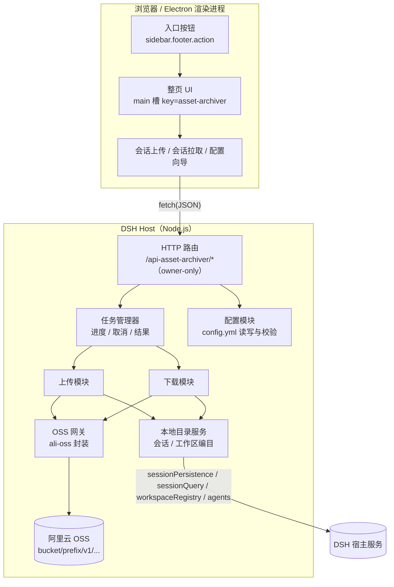
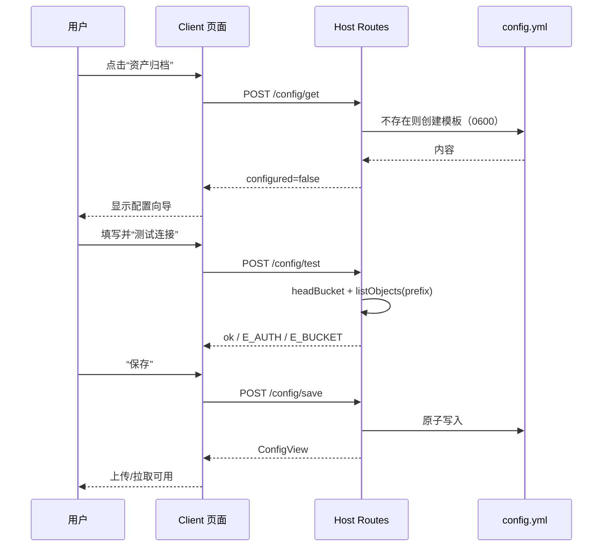
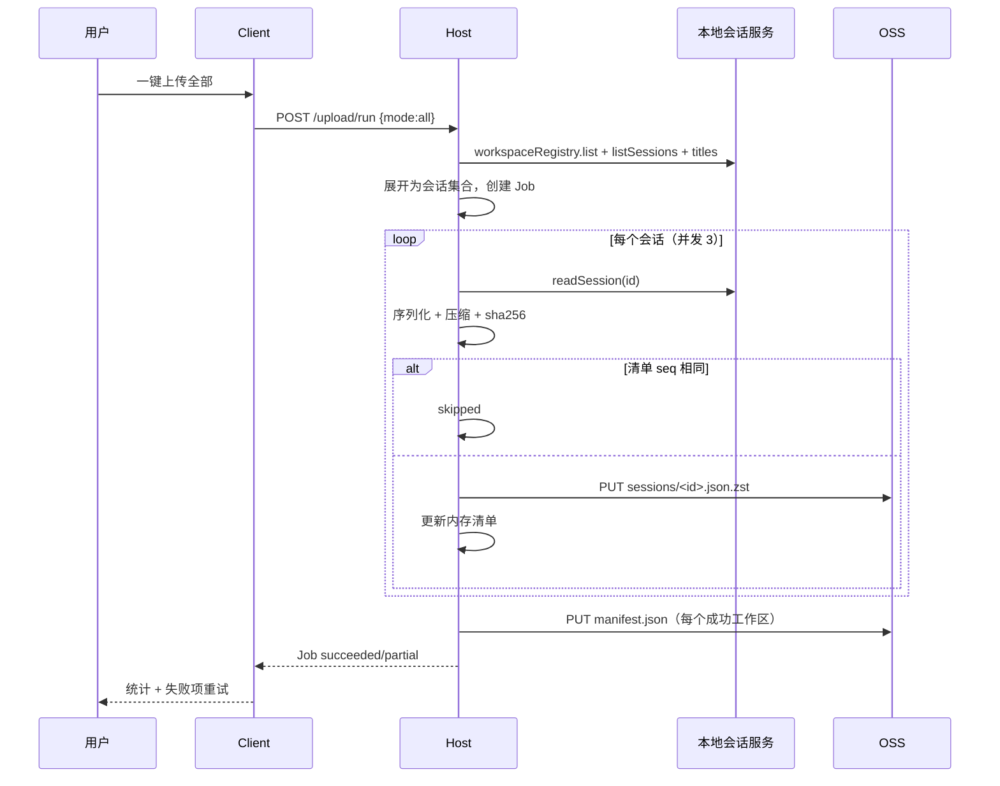
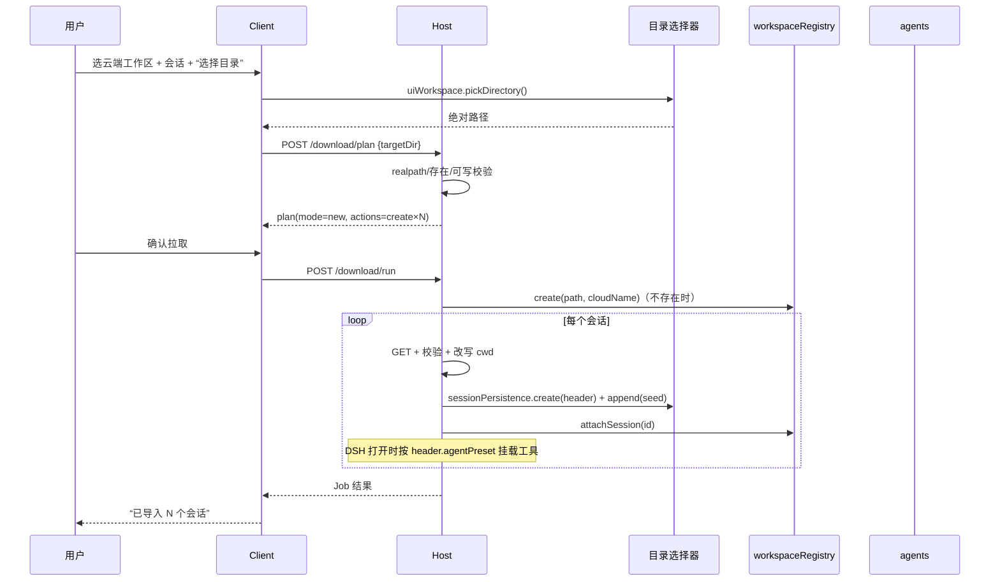

# dsh-asset-archiver 技术设计文档

| 项目 | 内容 |
| --- | --- |
| 文档编号 | DAA-TDD-001 |
| 文档版本 | v1.3.3（修复版） |
| 状态 | 恢复会话保留 agent preset，打开时由 DSH 挂载工具 |
| 日期 | 2026-11-27 |
| 依据 | 《dsh-asset-archiver——开发说明文档》（以下简称“需求原文”） |
| 目标宿主 | DeepSeek Harness 0.2.2-rc.5（本机实测基线），Node.js ≥ 24.9 |
| 适用读者 | 插件开发者、测试、评审人、后续维护者 |

| 修订 | 日期 | 内容 |
| --- | --- | --- |
| v0.1 | 2026-11-21 | 初始设计评审稿 |
| v0.2 | 2026-11-21 | 确认 Q1–Q4；入口改为不竞争槽位的自动追加；补充 v0.1 demo 实现与验证结果 |
| v1.0 | 2026-11-22 | TypeScript + esbuild 正式版；Host/Client 分层重构；22 项测试；真实 OSS 只读列举验证 |
| v1.1 | 2026-11-24 | 工作区文件按需上传/拉取；文件索引并入 manifest；28 项测试 |
| v1.2 | 2026-11-24 | 工作区文件改为树形目录；文件夹选择联动全部子文件；31 项测试 |
| v1.3 | 2026-11-24 | 拉取页新增“同步工作区文件”开关，默认关闭；33 项测试 |
| v1.3.1 | 2026-11-24 | 回退 1.4.0 独立浏览器页面；改为 shell.overlay 浮层 Dialog；35 项测试 |
| v1.3.2 | 2026-11-24 | 浮层尺寸改为 DSH 窗口宽度的 50%、高度的 70% |
| v1.3.3 | 2026-11-27 | 恢复会话保留 agentPreset，改为只落盘、不创建无预设 live Agent；预设缺失回退默认；37 项测试 |

---

## 目录

1. [文档说明](#1-文档说明)
2. [项目概述](#2-项目概述)
3. [需求规格](#3-需求规格)
4. [总体设计](#4-总体设计)
5. [数据设计](#5-数据设计)
6. [接口设计](#6-接口设计)
7. [模块详细设计](#7-模块详细设计)
8. [关键流程](#8-关键流程)
9. [安全设计](#9-安全设计)
10. [非功能设计与性能](#10-非功能设计与性能)
11. [兼容性设计](#11-兼容性设计)
12. [测试计划](#12-测试计划)
13. [交付物与工程化](#13-交付物与工程化)
14. [里程碑与排期](#14-里程碑与排期)
15. [风险与开放问题](#15-风险与开放问题)
16. [附录](#16-附录)

---

## 1. 文档说明

### 1.1 目的

本文将需求原文中的功能描述转化为可实施、可评审、可测试的技术设计，明确：

- 功能边界、验收标准与需求歧义的裁定；
- 插件在 DSH 运行时的接入点与宿主契约；
- 本地会话、云端 OSS、插件配置三类数据的结构与版本策略；
- 上传/下载/配置三大模块的接口、流程、错误模型与并发/失败语义；
- 安全、性能、兼容性、测试与交付安排。

### 1.2 范围

**范围内**：插件工程（Host + Client）、阿里云 OSS 存储、会话上传与拉取、首次配置向导、入口按钮与整页界面、错误处理、基础测试与打包安装。

**范围外（本期不做）**：

- 跨 DSH 大版本的会话格式迁移（V3 ↔ V4 互转）；
- 附件/图片对象（`attachmentId` 引用内容）的跨设备同步；
- 定时自动同步、多用户共享桶的账号体系；
- 与 `dsh-chat-import` 数据格式的互相转换；
- 独立操作系统窗口（见决策 D-01）。

### 1.3 术语

| 术语 | 含义 |
| --- | --- |
| DSH | DeepSeek Harness，本插件运行其 Web GUI（Electron/浏览器） |
| Host | 插件的主进程/half，运行于 DSH CLI 的 Node.js 环境，可直接使用宿主服务与文件系统 |
| Client | 插件的浏览器 half，通过 `window.__ModuleLoader__.load` 注入，渲染 UI |
| Slot | DSH Client 的 UI 扩展点，插件在具名槽位登记 React 组件 |
| 工作区 | DSH 的 Workspace，本地以目录绑定，云端以“工作区名称”为业务唯一标识 |
| 会话 | DSH Session，日志型会话，本插件以“会话 id”为业务唯一标识 |
| 云端工作区键 | 工作区名称经规范化/编码后得到的 OSS 目录名（`workspaceKey`） |
| 会话包 | 一次上传对应的、包含 header + 全部事件的压缩对象（session bundle） |
| 任务 | 一次上传/拉取批处理，有独立 id、进度、结果与取消能力 |

### 1.4 参考

- `@deepseek-ai/dsh-agent-preset` 技能 `dsh-doc` 的插件开发、UI 插件、配置持久化、用户操作与验证规范。
- 已安装插件 `dsh-chat-import`（v0.26.7）的入口按钮、路由与宿主读写实现（作为同类实现参照）。
- 已安装插件 `dsh-context`（v0.85.1）的主面板 + 侧栏面板图标注册方式（作为整页 UI 参照）。

---

## 2. 项目概述

### 2.1 背景

DSH 的会话与工作区保存在本机 `DSH_HOME` 下。用户在办公室电脑、家用电脑、笔记本之间切换时，会话无法自然迁移；手工拷贝目录既依赖 DSH 私有存储布局，又容易漏掉工作区登记与会话归属关系。

本插件使用阿里云 OSS 作为中转：把本机会话按“工作区 → 会话”两级结构上传，在另一台设备上按同一结构浏览并拉取，由 DSH 原生机制重新落盘、挂接工作区，从而在多设备之间延续会话。

### 2.2 目标

- G1：在 DSH 左下角提供与 `dsh-chat-import` 一致的入口体验，一键进入“资产归档”整页。
- G2：支持全量与任意粒度的会话上传，云端同工作区名 + 同会话 id 时覆盖，否则新增。
- G3：支持按云端工作区浏览、按会话多选拉取；新工作区由用户选择本地目录，已有工作区合并更新。
- G4：首次使用有完整的配置引导，配置保存在 `DSH_HOME/dsh-asset-archiver/config.yml`。
- G5：整个过程对用户可解释：进度、逐项结果、失败原因、可取消、可重试。

### 2.3 非目标

- 不替代 DSH 自带的会话列表与搜索；
- 不提供云端会话的在线预览/编辑；
- 不保证不同 DSH 大版本之间的会话兼容；
- 不承担 OSS 桶的开通、计费、RAM 授权等云资源运维。

### 2.4 典型用户场景

1. **换机迁移**：旧机“一键上传全部” → 新机首次配置 OSS → 拉取页逐个工作区选择本地目录并导入全部会话。
2. **增量同步**：旧机继续产生新会话 → 再次上传（仅变化项真正传输，未变化项跳过）→ 新机对同一工作区再次拉取（已存在会话跳过，只补充新增）。
3. **单会话取回**：误删或需要回滚某次会话 → 拉取页只勾选该会话，导入到已有工作区。
4. **工作区重建**：新设备上还没有对应目录 → 拉取时选择/新建目录，插件创建工作区并挂接会话。

---

## 3. 需求规格

### 3.1 功能需求

优先级：P0 = 首个可交付版本必须完成；P1 = 首个版本应有；P2 = 后续版本。

| 编号 | 需求 | 来源 | 优先级 | 验收标准 |
| --- | --- | --- | --- | --- |
| FR-01 | 左下角插件入口，名称为“资产归档”，位置与规格参照 `dsh-chat-import` | 需求原文 1 | P0 | 侧栏底部出现可点击按钮；宽侧栏显示图标+文字，窄栏（56px）显示图标并带 tooltip/`aria-label`；入口以唯一 id 注册，采用高位 order 追加到现有动作之后，不占用或替换其他插件的位置 |
| FR-02 | 点击入口进入“资产归档”插件页面 | 需求原文 2 | P0 | 主面板切换为整页页面；侧栏保持可用；可通过“关闭/返回”或点击会话返回对话；页面背景、文字、边框全部使用宿主主题令牌，浅/深色自动跟随 |
| FR-03 | 首次打开页面时在 `DSH_HOME/dsh-asset-archiver/` 创建 `config.yml` 并引导填写 | 需求原文“细节部分” | P0 | 首次 `GET /config` 后文件存在；页面展示配置向导；未配置时上传/拉取入口禁用并给出原因 |
| FR-04 | 配置校验与连接测试 | 需求原文 | P0 | 保存前做字段校验；提供“测试连接”，区分鉴权失败、桶不存在、网络失败、权限不足 |
| FR-05 | 上传页构建“工作区—会话”树形多选列表（两级均可多选） | 需求原文“上传模块” | P0 | 工作区行三态勾选；展开显示会话；父子选择联动；支持搜索 |
| FR-06 | 一键上传所有会话 | 需求原文 3 | P0 | 一次操作提交全部工作区全部会话；结果逐项可见 |
| FR-07 | 自由选择上传哪些会话 | 需求原文 3 | P0 | 可只选某些工作区，或只选某些会话；提交内容与勾选严格一致 |
| FR-08 | 云端同工作区名 + 同会话 id 覆盖，否则新增 | 需求原文“上传模块” | P0 | 上传后云端对象键确定；同 id 再次上传后 `uploadedAt`/内容更新；新 id 新增对象 |
| FR-09 | 拉取页云端工作区单选、工作区内会话多选 | 需求原文 4、下载模块 | P0 | 左侧工作区单选；选中后右侧加载会话列表并支持多选；未选工作区时不能提交 |
| FR-10 | 新工作区拉取时必须通过资源管理器选择本地目录 | 需求原文“下载模块” | P0 | 点击“选择目录”打开宿主原生目录选择器；取消则中止；所选目录在导入前被校验为存在且可写 |
| FR-11 | 已有工作区拉取时更新该工作区并合并会话 | 需求原文“下载模块” | P0 | 云端名称可匹配到本地工作区时不弹目录选择；标题不一致时更新；只新增/跳过勾选会话，不删除未勾选会话 |
| FR-12 | 云端以工作区名称为唯一标识，每个工作区一个独立文件夹 | 需求原文“细节部分” | P0 | OSS 目录结构为 `<prefix>/v1/workspaces/<workspaceKey>/`，每个工作区一个前缀；显示名保存在 manifest |
| FR-13 | 进度、逐项结果、失败重试 | 隐含于需求 3/4 | P1 | 长任务有总进度与当前项；结束给出成功/跳过/失败统计；失败项可一键重试 |
| FR-14 | 取消任务与可解释错误 | 隐含 | P1 | 运行中可取消；错误有稳定错误码与本地化文案；网络错误可重试 |
| FR-15 | 中英双语与可访问性 | 宿主规范 | P1 | 所有 UI 文案经 locale 服务；键盘可完成主要操作；勾选控件有 `role`/`aria-checked`；弹层支持 Esc 与焦点约束 |
| FR-16 | 未分组会话可见并可备份/恢复 | 需求隐含 | P2 | 上传树中单列“未分组”；拉取时按新工作区处理（需选目录），恢复后归入该工作区 |

### 3.2 非功能需求

| 编号 | 需求 | 指标 |
| --- | --- | --- |
| NFR-01 | 凭据安全 | 配置文件权限最小化；密钥不回传客户端、不写日志；传输强制 TLS |
| NFR-02 | 数据可靠性 | 上传幂等可重放；下载先校验后落盘；任何失败不得损坏已有本地会话 |
| NFR-03 | 性能 | 本地清单（≤2000 会话）≤2s；云端工作区列表（≤50 个）≤3s；内存峰值 ≤ 单会话大小 × 2 + 50MB |
| NFR-04 | 跨平台 | Windows / macOS / Linux；路径统一用 Node `path` 处理；目录选择走宿主能力 |
| NFR-05 | 兼容性 | 在声明的 DSH 基线上可安装、可启停；宿主服务缺失时降级而不是白屏 |
| NFR-06 | 可维护性 | TypeScript strict；Host/Client/Shared 分层；核心算法纯函数可单测 |
| NFR-07 | 可观测性 | 结构化日志（级别、任务 id、工作区键、会话 id、错误码），敏感字段脱敏 |
| NFR-08 | 可安装/可卸载 | 单 bundle 安装；禁用/卸载后不残留路由与定时器；本地配置与状态文件保留但不再被访问 |

### 3.3 需求歧义与设计裁定

需求原文有多处需要裁定，均在本设计中给出默认方案，并在 [15. 风险与开放问题](#15-风险与开放问题) 中列为待确认项。

| 编号 | 歧义 | 裁定（默认实现） | 理由 |
| --- | --- | --- | --- |
| A-01 | “点击按钮后进入插件页面（新建窗口）”中的“新建窗口” | **V1.3.1 起**实现为 **DSH 内浮层窗口**：`shell.overlay` 中的遮罩 + 居中 Dialog，参考 `dsh-session-manager` 的面板弹窗；不注册 `main` 面板 | 浮层窗口不替换会话主面板，且无需宿主窗口 API；关闭方式与宿主管理类弹窗一致 |
| A-02 | “更新已有工作区时覆盖本地工作区” | **已确认（Q2）**：允许删除本地会话。完整版提供显式“覆盖”策略（删除本地同 id 会话后重建）；默认仍为“跳过”，不删除未勾选或非冲突会话 | 用户确认允许删除；默认非破坏性可减少误操作，破坏性操作需显式选择 |
| A-03 | 拉取时本地已存在同 id 会话怎么办 | 冲突策略 `skip`（默认）/ `overwrite`（删除本地同 id 后重建，Q2 允许）/ `copy`（新建 `<原id>-<n>` 副本）；v0.1 demo 仅实现 `skip` | 会话 id 全局唯一，直接重建必须先删除；默认跳过最安全 |
| A-04 | 云端“工作区名称唯一”与 DSH“不同路径可同名”冲突 | 云端以规范化名称为键；同名不同路径的本地工作区在上传时用 `<编码名>~<路径哈希前8位>` 消歧，manifest 保留显示名 | 既满足“按名称组织”的可用性，又避免不同工作区被意外合并 |
| A-05 | “一键上传所有会话”是否包含已归档/未分组会话 | 设计目标：包含；已归档会话打标，未分组会话单列伪工作区。V1.0 先覆盖已归组工作区，未分组与归档筛选后续补充 | “所有”应按用户可见的全部会话理解；V1.0 以稳定交付优先 |

---

## 4. 总体设计

### 4.1 运行环境与宿主契约（经实测确认）

以下事实来自对本机运行中 DSH 的 `cordis_inspect_query` 查询、已安装插件源码与 `DSH_HOME` 实际目录的核对，是后续设计的硬约束。

| 事实 | 结论 | 核验方式 |
| --- | --- | --- |
| DSH 版本 | `0.2.2-rc.5`；`engines.node >= 24.9.0` | 安装包 `@deepseek-ai/dsh/package.json` |
| 会话落盘 | `DSH_HOME/sessions/<workspace-slug>/<sessionId>/session.v4.jsonl.zstd`；首行为 `{"type":"session","version":4,...}` 头部，其后为事件行 | 实际目录 + zstd 解压抽样 |
| 会话读写服务 | `sessionPersistence`：`list()`、`open(id,'read')`、`create(header)`（返回写句柄 append/flush/close）、`stat(id)` | Host Service 契约 |
| 会话查询服务 | `sessionQuery`：`listSessions()`、`readSession(id)`（返回 `{session, inheritedEventCount, events}`）、`readTitleSnapshots(ids)` | Host Service 契约 |
| 工作区服务 | `workspaceRegistry`：`list()`、`create(path,title)`、`resolveByPath(path)`；`Workspace` 提供 `path/title/sessionIds/attachSession/detachSession/setTitle/status` | Host Service 契约 |
| 工作区归组硬约束 | 会话只有在 `header.cwd` 与 `workspace.path`（真实路径）一致并被 `attachSession` 后才出现在该工作区；否则落入“未分组” | 已安装 `dsh-chat-import` 的工作区归组实现注释与宿主 `attachSession` 行为 |
| 创建会话 | `ctx.agents.create({sessionId, meta, seed, agentOptions, setup})` 会创建、发布并通知客户端会话列表；`sessionPersistence.create` 只落盘 | Host Service 契约 |
| SessionHeader 白名单 | `version/id/createdAt/isSeeded/delegationDepth/cwd/parentSession/origin/agentPreset`；`cwd` 必须为绝对路径；未知字段会被拒绝 | 已安装插件对宿主 header 校验的适配代码 |
| 左下角入口槽 | `sidebar.footer.action`（list，root 作用域），由 `.footerActions` 渲染全部条目并自动换行，无固定容量；`dsh-chat-import` 以 `id: chat-import, order: 0` 注册，本插件以唯一 id + `order: 100` 追加 | Slot 实时拓扑 + sidebar 渲染实现 |
| 整页主面板 | `main` 为 keyed 槽（已占用 `conversation`），插件可注册任意 key；`layout.selectPanel(panelId)` 可切换，未注册的 key 会抛错；`selectPanel(null)` 回到对话 | Client Service `layout` + Slot 目录 |
| 目录选择 | 客户端服务 `uiWorkspace.pickDirectory()` 打开宿主原生目录选择器；Host 侧另有 `directoryPickerController` | Client Service 契约 |
| 主题 | `--dsw-alias-bg-base`、`--dsw-alias-bg-layer-1/2`、`--dsw-alias-border-l1/l2`、`--dsw-alias-label-primary/secondary`、`--dsw-alias-brand-primary`、`--dsw-alias-state-*` 等令牌 | 实时 Theme 令牌表 |
| 路由 | `webServer.register` 支持 `kind: 'exact' | 'prefix'`；resource 路由可拿到 `peer`（当前 principal 为 owner） | Host Service 契约 + 已安装插件路由实现 |

> 注意：`sessions/<workspace-slug>` 的 slug 由宿主生成（本机样例 `--F-dsh-WorkSpace-dsh-plugin-develop--`），插件**不得**依赖其算法；本设计不直接读写这些文件，只在诊断/救援工具中作为最后手段。

### 4.2 架构



| 层 | 模块 | 职责 | 不做什么 |
| --- | --- | --- | --- |
| Client | `index.tsx` | 左下角按钮、浮层注册；点击打开浮层窗口 | 不直接访问 OSS/文件系统 |
| Client | `AssetArchiverWindow.tsx` | 遮罩、居中 Dialog、Esc/遮罩/按钮关闭 | 不切换会话主面板 |
| Client | `windowStore.ts` | 入口与浮层共享的打开状态 | 不持久化 |
| Client | `App.tsx` | 整页状态机、Tab、刷新、上传/拉取动作 | 不做数据持久化 |
| Client | `components/` | Button、Banner、ConfigForm、WorkspaceTable、结果面板、图标 | 不拼接 OSS 请求 |
| Client | `api.ts` | 统一 POST 封装与 `ApiError` | 不持有业务状态 |
| Host | `index.ts` | `apply`：装配服务并在 `webServer` 可用时注册路由 | 不做业务逻辑 |
| Host | `config.ts` | 定位/创建/校验/原子写 `config.yml`；密钥掩码 | 不读写 profile 的 `cordis.patch.yml` |
| Host | `oss.ts` | `OssGateway` 接口、`ali-oss` 实现、错误映射 | 不感知会话语义 |
| Host | `catalog.ts` | 本地工作区/会话编目、目标目录解析 | 不直接改会话文件 |
| Host | `session-restore.ts` | header 归一、保留 agentPreset、持久化直写、预设回退、工作区挂接 | 不做格式迁移 |
| Host | `app.ts` | 用例编排：配置、云端列表、上传、下载 | 不发布 UI |
| Host | `routes.ts` | POST-only JSON 路由、请求校验、错误映射、请求日志 | 不放业务逻辑 |
| Host | `logger.ts` / `dsh.ts` | 结构化脱敏日志；宿主服务最小结构类型 | 不实现业务 |
| Shared | `contract.ts` / `schema.ts` | 请求/响应/错误码；会话包与清单 schema | 不含运行时依赖 |

### 4.4 关键设计决策

| 编号 | 决策 | 备选 | 取舍理由 |
| --- | --- | --- | --- |
| D-01 | 页面形态：`shell.overlay` 浮层 Dialog（遮罩 + 居中面板） | `main` 槽整页；右栏 tab；独立浏览器页面 | 不替换会话界面，完全使用宿主主题/布局；与 `dsh-session-manager` 的面板弹窗同模式 |
| D-02 | Client↔Host 通道：`webServer` handler HTTP 路由 + `fetch` | 生成式 `ctx.remote`；会话命令；resource 路由 | resource 路由只答 GET/HEAD，上传/下载需要 POST，因此使用 handler 路由；连接准入由宿主 HTTP 载体负责 |
| D-03 | 会话读写：只走 `sessionPersistence` / `sessionQuery` / `agents` | 直接读写 `.jsonl.zstd` | 宿主 API 负责格式校验、并发与发布；直写文件与版本/压缩策略强耦合，跨版本必坏 |
| D-04 | 云端键：工作区名规范化 + 百分号编码；会话 id 原样 | 用本地路径做键；用 UUID 做键 | 名称可读、跨平台稳定；路径跨设备必然不同；UUID 不满足“按名称组织” |
| D-05 | 覆盖语义：上传按确定对象键覆盖；拉取默认跳过冲突，按 Q2 可显式覆盖（删除本地同 id 后重建） | 拉取时统一删除重建 | 默认安全，破坏性操作需显式选择 |
| D-06 | 凭据：**已确认（Q4）** 明文写入 `config.yml`，辅以权限收紧与掩码；credentials 迁移仅作后续可选 | 一开始就用 `ctx.credentials` | 私用插件，用户接受明文；保留后续加固空间 |
| D-07 | OSS SDK：`ali-oss`（纯 JS） | 手写 SigV4；S3 兼容客户端 | 官方 SDK 覆盖分片、重试、进度；避免自实现签名的高风险 |
| D-08 | 工程：TypeScript strict + esbuild；Host ESM、Client module-loader；`tsc --noEmit` 与 37 项测试 | 纯 JavaScript 直接运行 | V1.0 起以可维护性优先，构建与测试纳入 `npm run check` |
| D-09 | 版本基线：DSH 0.2.2-rc.5、会话格式 V4；不做跨代迁移 | 兼容 V3 宿主 | 迁移需要与 DSH 迁移器同步的复杂逻辑，本期明确不做 |
| D-10 | 未分组会话：伪工作区 `_ungrouped` | 忽略 | 备份完整性；拉取时按新工作区流程处理即可复用现有代码 |

---

## 5. 数据设计

### 5.1 本地数据与插件目录

```text
DSH_HOME/                                  # 默认 ~/.dsh（Windows: %USERPROFILE%\.dsh）
├── sessions/                              # 宿主所有会话（本插件只经宿主服务访问）
├── storages/workspace.json                # 宿主工作区登记（本插件只经 workspaceRegistry 访问）
└── dsh-asset-archiver/                    # 本插件私有目录
    ├── config.yml                         # OSS 连接配置（首次打开页面时创建）
    ├── state.json                         # 设备 id、云端工作区到本地工作区的绑定、最近同步时间
    └── logs/                              # 可选：诊断日志（P2）
```

- 插件私有目录不在 DSH profile 目录内，也不得读写 profile 的 `cordis.patch.yml`。
- `DSH_HOME` 解析顺序：`process.env.DSH_HOME` → `os.homedir() + '/.dsh'`；两者都不可用时返回 `E_HOME`，页面显示明确错误，而不是猜测路径。
- 所有写入使用“临时文件 + 原子替换”；POSIX 上 `config.yml` 权限 `0600`。

### 5.2 云端 OSS 布局

```text
<bucket>/
└── <prefix>/                                  # 默认 dsh-asset-archiver
    └── v1/
        └── workspaces/
            ├── <workspaceKey>/
            │   ├── manifest.json              # 工作区元数据 + 会话索引（覆盖写）
            │   └── sessions/
            │       ├── <sessionId>.json.zst   # 单个会话包（覆盖写）
            │       └── ...
            └── <workspaceKey2>/
                └── ...
```

设计说明：

- **工作区一个文件夹**：满足 FR-12；`workspaceKey` 由名称编码而来，可读且跨平台稳定。
- **会话一个对象**：对象键确定，天然实现“同工作区同会话 id 覆盖、否则新增”（FR-08），且失败重试幂等。
- **清单与对象分离**：`manifest.json` 提供快速树形展示与会话元数据；`sessions/` 下的对象是事实来源。清单缺失或过期时，列举对象仍能恢复会话列表（元数据降级为“未知，可修复”）。
- **大文件**：>5 MiB 使用分片上传；分片仅在单对象内，不影响对象键语义。
- **版本化建议**：强烈建议桶开启版本控制，使“覆盖”可通过历史版本回滚，降低误覆盖风险。

### 5.3 `config.yml`

首次打开页面时创建，字段与需求原文参考格式一致，另加少量可选调优项。

```yaml
aliyun:
  oss:
    endpoint: oss-rg-china-mainland.aliyuncs.com   # 必填；允许省略 scheme，禁止 http://
    region: rg-china-mainland                       # 必填
    access-key-id: LTAI5t****************           # 必填
    access-key-secret: ****************             # 必填（回传时永远置空）
    bucket-name: wisdom-academy                     # 必填，3-63 位小写 DNS 名
    # 可选
    prefix: dsh-asset-archiver                      # 对象前缀；不得以 / 开头，不得含 ..
    timeout-ms: 30000                               # 单请求超时
    concurrency: 3                                  # 1-8，默认 3
    part-size-mb: 5                                 # 分片阈值
```

校验规则：

| 字段 | 规则 | 失败错误码 |
| --- | --- | --- |
| `endpoint` | 非空；去空白；允许 `https://` 前缀；拒绝 `http://`（除非未来显式允许不安全模式）；不含路径 | `E_CONFIG` |
| `region` | 非空字符串 | `E_CONFIG` |
| `access-key-id` | 非空；长度 8–64；允许字母数字与 `-` | `E_CONFIG` |
| `access-key-secret` | 非空（保存时若回传空串表示“保留原值”） | `E_CONFIG` |
| `bucket-name` | `^[a-z0-9][a-z0-9-]{1,61}[a-z0-9]$` | `E_CONFIG` |
| `prefix` | 可选；`^[A-Za-z0-9._\-/]+$`；不以 `/` 开头；不含 `..` 与连续 `//` | `E_CONFIG` |
| `timeout-ms` / `concurrency` / `part-size-mb` | 整数范围校验 | `E_CONFIG` |

读写语义：

- `GET /config`：确保目录与文件存在（首次写入带注释的模板）；返回**脱敏值**（AK 形如 `LTAI****CX8`，SK 仅返回 `set: true/false`）。
- `POST /config/save`：校验 → 合并旧值（SK 为空则保留）→ 原子写 → 返回脱敏值；不在此处测试连接。
- `POST /config/test`：可使用“未保存的表单值”（同样遵守“SK 空=用已保存值”）；执行 `headBucket` + 对 prefix 做一次 `listObjectsV2(maxKeys=1)`；返回区分后的结果与耗时。
- 文件注释仅在首次模板中存在；保存后为规范化 YAML（不保证保留注释）。

### 5.4 `workspaceKey` 编码

目标：可读、可逆显示、不产生路径分隔符、跨平台一致、长度可控。

```text
workspaceKey(name):
  n = NFC(name).trim() with internal whitespace collapsed to one space
  enc = percentEncodeUtf8(n, keep = A-Z a-z 0-9 . _ - 和空格)
  if enc.length <= 160: key = enc
  else: key = enc[0..120] + "~" + sha256(n)[0..7]
  # 同名不同本地路径的并发工作区：key = key + "~" + sha256(realpath)[0..7]
  # 极端情况下 key 仍冲突：在 UI 中要求用户重命名，而不是静默合并
```

- `manifest.name` 保存原始显示名；`manifest.key` 保存最终键；两者都参与匹配。
- 会话对象键中的 `sessionId` 只允许 `^[A-Za-z0-9._:-]{1,128}$`；其他字符百分号编码并记录在 manifest，避免路径注入。

### 5.5 `manifest.json`

```json
{
  "schemaVersion": 1,
  "workspace": {
    "key": "dsh-plugin-develop",
    "name": "dsh-plugin-develop",
    "sourcePath": "F:\\dsh-WorkSpace\\dsh-plugin-develop",
    "createdAt": "2026-11-18T18:06:29.088Z"
  },
  "sessions": [
    {
      "id": "session-9c68d8e5-f035-4aeb-98bb-42f50c6a820f",
      "title": "修复登录态失效",
      "createdAt": 1795268419811,
      "updatedAt": 1795269000000,
      "lastEventSeq": 264,
      "eventCount": 265,
      "uncompressedBytes": 1202216,
      "sha256": "9f2c...e1",
      "formatVersion": 4,
      "agentPreset": "standard",
      "subagent": false,
      "objectKey": "dsh-asset-archiver/v1/workspaces/dsh-plugin-develop/sessions/session-9c68d8e5-f035-4aeb-98bb-42f50c6a820f.json.zst",
      "encoding": "zstd",
      "uploadedAt": "2026-11-21T13:41:58.000Z",
      "uploadedBy": "device-7f3a..."
    }
  ],
  "updatedAt": "2026-11-21T13:41:58.000Z",
  "writer": { "tool": "dsh-asset-archiver", "version": "0.1.0", "deviceId": "device-7f3a..." }
}
```

- `sessions` 以 `id` 唯一；清单整体覆盖写。
- 读路径以“对象列举 + 清单合并”为准：对象存在但清单缺失 → 以 `id` 为标题占位并标记 `indexStale: true`；UI 提供“修复索引”（逐个读取会话包头部补全）。
- 清单写入发生在该批会话对象全部成功之后；部分失败时不写清单，已写对象留待下次覆盖或修复索引。

### 5.6 会话包（session bundle）

```json
{
  "bundleVersion": 1,
  "tool": "dsh-asset-archiver",
  "toolVersion": "0.1.0",
  "exportedAt": "2026-11-21T13:41:58.000Z",
  "encoding": "zstd",
  "formatVersion": 4,
  "session": {
    "header": {
      "version": 4,
      "id": "session-9c68d8e5-f035-4aeb-98bb-42f50c6a820f",
      "createdAt": 1795268419811,
      "cwd": "F:\\dsh-WorkSpace\\dsh-plugin-develop",
      "isSeeded": false,
      "delegationDepth": 0,
      "agentPreset": "standard"
    },
    "inheritedEventCount": 0,
    "title": "修复登录态失效",
    "eventCount": 265,
    "lastEventSeq": 264,
    "lastEventTime": 1795269000000
  },
  "events": [
    { "type": "permission/preset", "seq": 0, "time": 1795268419816, "data": { "preset": "workspace-write" } }
  ],
  "attachments": []
}
```

- `events` 为完整原始日志事件数组；`seq` 连续，`surfaceOp` 等字段原样保留。
- `sha256` 计算对象为**未压缩**的 `JSON.stringify({header, inheritedEventCount, events})`（字段顺序由写入方固定），写入 manifest；下载时重算比对。
- 压缩：`zstd`（Node ≥24.9 内置 `zlib.zstdCompressSync`）；如运行时不支持则回退 `gzip`，manifest/包内 `encoding` 如实记录，下载端按声明解压。
- 安全上限：单会话未压缩 > 256 MiB 拒绝（`E_LIMIT`）；防止一次性快照耗尽内存。

### 5.7 `state.json`

```json
{
  "schemaVersion": 1,
  "deviceId": "device-7f3a9c2e",
  "createdAt": "2026-11-21T13:41:58.000Z",
  "workspaceBindings": {
    "dsh-plugin-develop": {
      "workspaceId": "f525990a-94c6-4d50-9641-e69759dee367",
      "path": "F:\\dsh-WorkSpace\\dsh-plugin-develop",
      "name": "dsh-plugin-develop",
      "lastPulledAt": "2026-11-21T14:02:00.000Z"
    }
  },
  "lastUploadAt": "2026-11-21T13:50:00.000Z",
  "lastPullAt": "2026-11-21T14:02:00.000Z"
}
```

- 绑定用于“已有工作区”判定；使用前必须校验 `workspaceRegistry.get(id)` 存在且 `status() === 'ok'`。
- 绑定失效时按名称回退匹配；仍无匹配再要求选择目录。
- `state.json` 损坏时：备份为 `state.json.corrupt-<时间戳>`，重建空状态（不影响会话数据）。

### 5.8 版本策略

| 数据 | 版本字段 | 兼容规则 |
| --- | --- | --- |
| 会话包 | `bundleVersion` | 读取时 `> 当前支持` → `E_UNSUPPORTED_BUNDLE`，提示升级插件；未知字段忽略 |
| 清单 | `schemaVersion` | 同上；`1` 为本期唯一支持版本 |
| 配置 | 无版本字段 | 缺字段用默认值；未知字段保留（保存时原样写回，避免降级丢配置） |
| 状态 | `schemaVersion` | 高版本只读并提示，不覆盖写 |

---

## 6. 接口设计

### 6.1 Client ↔ Host HTTP API

统一约定：

- 全部为 `POST`，`Content-Type: application/json`；路径前缀 `/api-asset-archiver/`，以 `prefix` 路由注册。
- 路由处理器可拿到 `peer`；仅允许 `peer.principal.kind === 'owner'`，否则 `403 E_FORBIDDEN`。
- 请求体上限 1 MiB（上传/下载请求只有元数据，不含文件内容）。
- 响应：成功 `{ "ok": true, "data": ... }`；失败 `{ "ok": false, "error": { "code", "message", "retryable", "details?" } }`。
- 所有路径参数在服务端重新校验，不信任客户端清单。

| 方法 | 路径 | 请求 | 成功响应 | 说明 |
| --- | --- | --- | --- | --- |
| POST | `/config/get` | `{}` | `ConfigView` | 首次调用即创建 `config.yml` |
| POST | `/config/save` | `ConfigInput` | `ConfigView` | 校验并原子写 |
| POST | `/config/test` | `ConfigInput`（可为空值表示用已保存） | `{ ok, latencyMs, bucket, prefix }` | 不落盘 |
| POST | `/local/tree` | `{ includeArchived?: boolean }` | `LocalTree` | 本地工作区—会话树 |
| POST | `/local/validate-dir` | `{ path }` | `{ path, canonicalPath, exists, writable, workspaceId?, name? }` | 拉取前校验目录 |
| POST | `/cloud/workspaces` | `{ refresh?: boolean }` | `{ workspaces: CloudWorkspace[] }` | 列举工作区（带本地匹配信息） |
| POST | `/cloud/sessions` | `{ workspaceKey }` | `{ workspace: CloudWorkspace, sessions: CloudSession[] }` | 读取工作区清单 |
| POST | `/download/plan` | `DownloadRequest` | `DownloadPlan` | 预检：目标解析、冲突、预计动作 |
| POST | `/download/run` | `DownloadRequest` | `{ jobId }` | 启动拉取任务 |
| POST | `/upload/run` | `UploadRequest` | `{ jobId }` | 启动上传任务 |
| POST | `/job/get` | `{ jobId }` | `Job` | 轮询任务 |
| POST | `/job/cancel` | `{ jobId }` | `Job` | 取消任务 |
| POST | `/job/retry-failed` | `{ jobId }` | `{ jobId }` | 仅重试失败项 |

`ConfigView`：

```json
{
  "configured": true,
  "configPath": "D:\\DeepSeek\\.dsh\\dsh-asset-archiver\\config.yml",
  "values": {
    "endpoint": "oss-rg-china-mainland.aliyuncs.com",
    "region": "rg-china-mainland",
    "accessKeyIdMasked": "LTAI****CX8",
    "accessKeySecretSet": true,
    "bucketName": "wisdom-academy",
    "prefix": "dsh-asset-archiver"
  },
  "defaults": { "prefix": "dsh-asset-archiver", "concurrency": 3, "timeoutMs": 30000 }
}
```

`LocalTree`：

```json
{
  "workspaces": [
    {
      "id": "f525990a-...",
      "name": "dsh-plugin-develop",
      "path": "F:\\dsh-WorkSpace\\dsh-plugin-develop",
      "status": "ok",
      "sessions": [
        {
          "id": "session-9c68d8e5-...",
          "title": "修复登录态失效",
          "createdAt": 1795268419811,
          "updatedAt": 1795269000000,
          "lastEventSeq": 264,
          "eventCount": 265,
          "bytes": 1202216,
          "archived": false,
          "subagent": false
        }
      ]
    }
  ],
  "ungrouped": [
    { "id": "session-...", "title": "未命名会话", "createdAt": 1795268419811, "archived": false, "subagent": false }
  ]
}
```

`UploadRequest`：

```json
{
  "mode": "all",
  "workspaceIds": [],
  "sessions": [{ "workspaceId": "f525990a-...", "sessionId": "session-9c68d8e5-..." }],
  "includeUngrouped": true,
  "includeArchived": true
}
```

- `mode: "all"`：忽略 `sessions`，上传所有工作区全部会话（受 `includeUngrouped`/`includeArchived` 控制）。
- `mode: "selection"`：以上传 `sessions` 为准；`workspaceIds` 仅用于工作区级选择（展开为其全部会话），最终仍归一为会话集合，避免歧义。

`DownloadRequest`：

```json
{
  "workspaceKey": "dsh-plugin-develop",
  "sessionIds": ["session-9c68d8e5-..."],
  "targetDir": "D:\\Work\\dsh-plugin-develop",
  "conflictPolicy": "skip",
  "updateWorkspaceTitle": true
}
```

- `targetDir`：云端工作区在本地无匹配时必填；有匹配时可省略，服务端使用绑定的本地路径。
- `conflictPolicy`：`skip`（默认）或 `copy`。
- `updateWorkspaceTitle`：已有工作区时是否把本地标题更新为云端名称，默认 `true`。

`DownloadPlan`：

```json
{
  "workspace": { "key": "dsh-plugin-develop", "name": "dsh-plugin-develop" },
  "target": {
    "mode": "existing",
    "workspaceId": "f525990a-...",
    "path": "F:\\dsh-WorkSpace\\dsh-plugin-develop",
    "canonicalPath": "F:\\dsh-WorkSpace\\dsh-plugin-develop"
  },
  "sessions": [
    { "id": "session-9c68d8e5-...", "title": "修复登录态失效", "action": "create", "newId": null },
    { "id": "session-aaaa...", "title": "旧会话", "action": "skip", "reason": "local-exists" }
  ],
  "summary": { "create": 3, "skip": 1, "copy": 0, "invalid": 0 }
}
```

`Job`：

```json
{
  "id": "job-01J...",
  "kind": "upload",
  "state": "running",
  "startedAt": "2026-11-21T13:41:58.000Z",
  "finishedAt": null,
  "total": 17,
  "done": 5,
  "failed": 0,
  "skipped": 2,
  "bytesDone": 5242880,
  "bytesTotal": 47185920,
  "current": { "workspaceName": "dsh-plugin-develop", "sessionId": "session-...", "title": "修复登录态失效" },
  "items": [
    { "key": "w:dsh-plugin-develop/s:session-...", "title": "修复登录态失效", "status": "ok", "bytes": 1202216 },
    { "key": "w:dsh-plugin-develop/s:session-aaaa", "title": "旧会话", "status": "skipped", "reason": "unchanged" }
  ],
  "error": null
}
```

- 任务状态机：`queued → running → succeeded | partial | failed | cancelled`。
- `partial`：至少一项失败且至少一项成功；`failed`：无成功项。
- 同一时刻同一类型只允许一个运行中任务；重复请求返回 `409 E_BUSY`。
- 任务结果在内存保留 10 分钟（或进程存活期间），供轮询与重试。

### 6.2 Host 内部模块接口（TypeScript 签名，供实现与测试）

```ts
// shared/contract.ts
export interface ConfigStore {
  ensure(): Promise<ConfigView>                 // 首次创建模板
  read(): Promise<ConfigView>
  save(input: ConfigInput): Promise<ConfigView>
  resolved(): Promise<ResolvedConfig>           // 含明文密钥，仅 Host 内存使用
}

export interface OssGateway {
  testConnection(signal?: AbortSignal): Promise<ConnectionTestResult>
  listWorkspaceKeys(signal?: AbortSignal): Promise<string[]>
  getJson<T>(key: string, signal?: AbortSignal): Promise<T | null>
  putJson(key: string, value: unknown, signal?: AbortSignal): Promise<void>
  putSessionObject(key: string, body: Uint8Array, signal?: AbortSignal, onProgress?: (n: number) => void): Promise<void>
  getObject(key: string, signal?: AbortSignal): Promise<Uint8Array>
  listSessionKeys(workspaceKey: string, signal?: AbortSignal): Promise<string[]>
}

export interface LocalCatalog {
  tree(options?: { includeArchived?: boolean }): Promise<LocalTree>
  resolveSessions(request: UploadRequest): Promise<LocalSessionRef[]>  // 展开选择
  readSession(ref: LocalSessionRef): Promise<SessionLogSnapshot>
  workspaceSnapshot(id: string): Promise<{ id: string; name: string; path: string; status: string } | null>
  existsSession(id: string): Promise<boolean>
  createSession(input: CreateSessionInput): Promise<{ sessionId: string }>
  attachToWorkspace(workspaceId: string, sessionId: string): Promise<void>
  resolveWorkspaceByPath(path: string): Promise<{ id: string; path: string; title: string } | null>
  createWorkspace(path: string, title: string): Promise<{ id: string; path: string; title: string }>
  setWorkspaceTitle(workspaceId: string, title: string): Promise<void>
}

export interface UploadService {
  run(request: UploadRequest, signal: AbortSignal, job: JobReporter): Promise<JobSummary>
}

export interface DownloadService {
  plan(request: DownloadRequest): Promise<DownloadPlan>
  run(request: DownloadRequest, signal: AbortSignal, job: JobReporter): Promise<JobSummary>
}
```

### 6.3 Client 侧宿主服务调用

| 能力 | 调用 | 不可用时的降级 |
| --- | --- | --- |
| 注册入口 | `ctx.slots.inject('sidebar.footer.action', () => ctx.slots.register({name:'sidebar.footer.action', id:'asset-archiver', order:100, label:()=>'资产归档'}, EntryButton))`（高位追加，不占用既有数值位） | 无（槽缺失则插件 UI 不出现，记录诊断） |
| 浮层窗口 | `openAssetWindow()`（模块级 store）→ `shell.overlay` 中的 `AssetArchiverWindow` | 无（浮层组件缺失则入口无响应，记录诊断） |
| 关闭窗口 | 浮层关闭按钮 / 遮罩点击 / Esc → `closeAssetWindow()` | — |
| 目录选择 | `ctx.get('uiWorkspace')?.pickDirectory()` | 回退为手动输入路径 |
| 文案 | `ctx.get('locale')`：`register(NS, dicts)`、`bind(NS)` | 内置中文兜底字典 |
| 主题 | 仅使用 `--dsw-alias-*` CSS 变量 | 缺失令牌时回退浏览器默认色（不写死品牌色） |

### 6.4 错误码

| 错误码 | HTTP | 含义 | 可重试 | 用户处置 |
| --- | --- | --- | --- | --- |
| `E_FORBIDDEN` | 403 | 非 owner 或信任围栏拒绝 | 否 | 无 |
| `E_NOT_CONFIGURED` | 409 | 尚未完成 OSS 配置 | 否 | 打开配置向导 |
| `E_CONFIG` | 400 | 配置字段不合法 | 否 | 修正字段 |
| `E_HOME` | 500 | 无法定位 `DSH_HOME` | 否 | 检查环境 |
| `E_AUTH` | 502 | OSS 鉴权失败（AK/SK 错、RAM 无权限） | 否 | 核对 AK/SK 与 RAM 策略 |
| `E_BUCKET` | 502 | 桶不存在 / region/endpoint 不匹配 | 否 | 核对桶与地域 |
| `E_NETWORK` | 502 | DNS、连接、TLS、超时 | 是 | 检查网络后重试 |
| `E_TIMEOUT` | 504 | 单请求超时 | 是 | 重试或调大 `timeout-ms` |
| `E_NOT_FOUND` | 404 | 工作区/会话/对象不存在 | 否 | 刷新列表 |
| `E_CORRUPT` | 422 | 会话包/清单损坏、哈希不符 | 否 | 重新上传该会话 |
| `E_UNSUPPORTED_BUNDLE` | 422 | bundle/清单版本高于插件支持 | 否 | 升级插件 |
| `E_FORMAT_VERSION` | 422 | 云端会话格式与本地宿主不兼容 | 否 | 在兼容版本设备上操作 |
| `E_CONFLICT` | 409 | 会话 id 冲突且策略不允许 | 否 | 改选“跳过”或“副本” |
| `E_BUSY` | 409 | 同类任务已在运行 | 否 | 等待或取消 |
| `E_LIMIT` | 413 | 单会话过大 / 列表过大 | 否 | 拆分或升级限制 |
| `E_CANCELLED` | 499 | 用户取消 | — | — |
| `E_INTERNAL` | 500 | 未分类异常（详情写日志） | 视情况 | 重试并回报日志 |

### 6.5 幂等、重试与并发

- **上传幂等**：同一会话的对象键固定；重复上传等于覆盖；跳过判断基于 `lastEventSeq`（清单记录）与本地最新 seq 的比较，相等则 `skipped: unchanged`。
- **下载幂等**：`/download/plan` 明确每项动作；执行时再次检查本地是否存在（防预检后变化）；重复拉取已存在会话默认跳过。
- **重试**：仅对 `E_NETWORK`/`E_TIMEOUT`/OSS 5xx/429 自动重试 3 次，指数退避（500ms 起，×2，加抖动），尊重 `Retry-After`；鉴权/参数错误不重试。
- **并发**：任务内并发默认 3；按字节加权（>64 MiB 的会话独占一个并发位），避免大文件同时占满内存与带宽。
- **取消**：任务持有 `AbortController`；取消后不再发起新对象传输，正在传输的分片尽力 `abortMultipartUpload`；已成功的对象保留（下次覆盖），不写清单。
- **进程退出**：任务状态只在内存；重启后任务丢失，但已上传对象/已下载会话仍有效，用户可重新执行（依靠幂等与跳过判断）。

---

## 7. 模块详细设计

### 7.1 配置模块

职责：首次创建、读取、校验、保存、测试连接、脱敏。

流程：

1. 页面加载 → `POST /config/get`。
2. Host `ConfigStore.ensure()`：
   - 计算 `configPath`；
   - 不存在则 `mkdir -p` 并写入模板（含注释与空值），权限 `0600`；
   - 解析 YAML，字段缺失用默认值；
   - 返回 `configured = 必填字段全部非空`。
3. 未配置：页面展示向导；`保存` 调 `/config/save`；`测试连接` 调 `/config/test`。
4. 已配置：页面顶部显示 `已连接 / 未连接` 状态；允许随时编辑。

边界：

- YAML 解析失败：保留原文件，返回 `E_CONFIG` 与解析错误位置；UI 提供“打开配置文件所在目录”的路径文本（不自动修复）。
- 空 SK 保存：保留旧值；显式“清空凭据”需要单独的确认操作（P2）。
- 保存失败：返回具体原因（权限、磁盘），不返回部分写入。
- 并发保存：使用内存互斥串行化；后写覆盖先写。

测试连接：

```text
client = new OSS({ region, endpoint, accessKeyId, accessKeySecret, bucket, secure: true, timeout })
try headBucket() → 成功
try listObjectsV2({ prefix: prefix + '/', maxKeys: 1 }) → 验证前缀可读
记录 latency; 错误映射 E_AUTH / E_BUCKET / E_NETWORK / E_TIMEOUT
```

### 7.2 上传模块

#### 7.2.1 本地编目

数据来源：

- 工作区：`workspaceRegistry.list()`；每个 `Workspace` 的 `id/title/path/status/sessionIds`。
- 会话元数据：`sessionQuery.readTitleSnapshots(ids)` 取标题与 `updatedAt`；`sessionPersistence.list()` 取 `sizeBytes/revision`（不可用时大小记 0）。
- 未分组：`sessionQuery.listSessions()` 的全部 id 减去所有 `workspace.sessionIds` 的并集；已归档集合来自 `workspaceRegistry` 的归档信息（若可读）。
- 会话 id 到工作区映射以 `workspace.sessionIds` 为准（宿主保证其按 `cwd` 过滤）。

展示排序：工作区按宿主登记顺序；会话按 `updatedAt` 降序（无更新时间用 `createdAt`）。

#### 7.2.2 选择展开

- 工作区全选 → 其 `sessionIds` 全部；未分组全选 → `ungrouped` 全部。
- 最终请求归一为会话集合 `{workspaceId | '_ungrouped', sessionId}`；服务端再次校验会话存在且属于该工作区，防止前端状态过期。

#### 7.2.3 上传单个会话

```text
1. sessionQuery.readSession(id) → { session: header, inheritedEventCount, events }
2. 计算 title（readTitleSnapshots 结果，缺失则空）、lastEventSeq、lastEventTime、eventCount、uncompressedBytes
3. 组装 bundle（5.6），JSON.stringify 后计算 sha256
4. zstd 压缩（或 gzip），得到 body
5. 与清单中同 id 记录比较：lastEventSeq 相同且 sha256 相同 → skipped
6. oss.putSessionObject(objectKey, body)
7. 成功后更新内存中的 manifest 条目
```

覆盖语义：对象键固定为 `<root>/v1/workspaces/<key>/sessions/<id>.json.zst`；覆盖即 `PUT` 同键。若桶开启版本控制，旧版本保留在 OSS 历史中。

#### 7.2.4 清单更新

- 一个工作区内所有选中会话成功后，重新生成 `manifest.json` 并 `putJson`。
- 部分失败：不写清单；已成功对象在下次上传时按跳过/覆盖逻辑重新纳入。
- 清单合并：保留清单中未在本批但对象仍存在的会话条目（避免“只上传一个会话”把其他条目从索引里删掉）；条目元数据以本批为准，其余原样保留。

#### 7.2.5 工作区键与消歧

- 以上传时本地工作区 `title` 计算 key。
- 若不同本地工作区（不同 `path`）得到同一 key，第二个及以后追加 `~<realpath 哈希8>`；UI 上传前提示“同名工作区将分别归档”。
- 与云端已有工作区匹配：先按 `key`，再按 manifest `name` 精确匹配（NFC、去首尾空白后比较）；匹配成功视为同一工作区合并。

#### 7.2.6 结果

- 统计：`uploaded / skipped / failed`，字节数，耗时。
- 失败项带错误码、可读原因、可重试；用户可“重试失败项”。
- 上传不改变本地任何会话数据。

### 7.3 下载模块

#### 7.3.1 云端浏览

- `listWorkspaceKeys`：`listObjectsV2(prefix=<root>/v1/workspaces/, delimiter='/')` 取 common prefixes。
- 每个前缀读取 `manifest.json`（并发 4，失败降级为“名称=key、会话数未知”）。
- 返回 `CloudWorkspace { key, name, updatedAt, sessionCount, local?: {workspaceId,path}, indexStale? }`。
- `local` 匹配顺序：`state.json` 绑定 → 本地工作区标题精确匹配（唯一时）→ 无。

#### 7.3.2 目标解析

```text
if request.targetDir 提供:
   canonical = realpath(targetDir); 必须存在且为目录、可写
   若该路径已属于某工作区 → mode=existing
   否则 → mode=new（createWorkspace(canonical, cloudName)）
else:
   绑定有效 → mode=existing
   标题唯一匹配 → mode=existing
   否则 → 返回 plan.target.mode=needs-directory，UI 弹出目录选择
```

- 新工作区：`workspaceRegistry.create(canonicalPath, cloudName)`；目录由用户选择（FR-10），插件不代建目录（除用户显式新建）。
- 已有工作区：使用其 `path`；`updateWorkspaceTitle && title !== cloudName` 时 `setTitle(cloudName)`。

#### 7.3.3 逐会话恢复

```text
1. getObject(objectKey) → 校验 bundleVersion / schema
2. 解压 → 解析 → 校验 sha256、events 连续性
3. formatVersion 与本地宿主当前格式不一致 → E_FORMAT_VERSION（整项失败）
4. 本地是否已存在同 id（sessionPersistence.stat / list）：
   skip → 记 skipped
   copy → newId = mintCopyId(id)（<id>-<n>）
5. header 归一：
   cwd = 目标工作区 canonical path（绝对路径）
   parentSession：若父会话在本地不存在 → 删除并标记 warning
   agentPreset：保留；若目标 agentPresets.resolve 找不到该 id，
               则 resolve(undefined) 回退默认预设并标记 warning
   其他白名单字段原样保留
6. sessionPersistence.create(header) + handle.append(events) + flush + close
   只落盘，不调用 agents.create；不能创建一个没有 preset 组合的 live Agent
7. workspace.attachSession(sessionId)（按宿主的 cwd 校验归组）
8. 记入 state.json 绑定与 lastPulledAt
```

说明：

- 只落盘的会话不会主动通知客户端，拉取后需刷新会话列表；打开会话时 DSH 的 `session-controller` 读取 `header.agentPreset`，调用 `composeAgent`/`agentPresets.mount`，工具、persona 与 skill 才会恢复。
- `attachSession` 失败不阻断会话创建，但该项标记 warning，并在结果中提示“会话已导入但未归组”。
- 1.3.2 及更早版本已经落盘的会话 header 没有 `agentPreset`，需要删除本地副本后重新拉取。
- 不删除、不修改任何本地已有会话；`copy` 产生新 id，可能造成同一会话多份，需在 UI 明示。

#### 7.3.4 冲突与批量

- `plan` 阶段标记每项动作；`run` 阶段再次校验，防止预检后本地新增。
- 批量失败不影响其他项；最终 `partial`。
- 取消后已完成项保留；未开始项不执行；结果如实汇报。

### 7.4 任务与进度

- `JobManager` 维护 `Map<jobId, JobRuntime>`；`JobRuntime` 持有 `AbortController`、进度、逐项状态、完成 Promise。
- 初始化：`total` = 会话数；`bytesTotal` = 本地/云端已知大小之和（未知按 0）。
- 进度更新节流：最多每 200ms 推送一次内存快照；客户端 500ms 轮询。
- 事件：`item-start`、`item-done`、`item-skipped`、`item-failed`、`job-done`。
- 结果保留 10 分钟后清理；运行中任务在插件卸载时统一 abort。

### 7.5 客户端页面设计

#### 7.5.1 入口

```text
┌──────────────────────────────┐
│  … 会话列表 …                │
│                              │
│  ⚙ 设置    🗄 资产归档       │  ← sidebar.footer.action
└──────────────────────────────┘
```

- 宽侧栏：图标 + “资产归档”；窄栏：图标 + `title`/`aria-label`。
- 与 `dsh-chat-import` 的“导入会话”同处底部动作列表：不声明竞争位，以 `order: 100` 追加到既有动作之后（`chat-import` 为 0、`session-manager` 为 30），宿主按列表布局自动换行/收纳。
- 点击：打开 `shell.overlay` 浮层窗口；不切换主面板。
- 不做“无会话时隐藏”等条件显示；入口始终可用。

#### 7.5.2 页面骨架

> V1.3.1 起该布局由 `shell.overlay` 浮层窗口承载，不再占用 DSH 主面板。

```text
┌─────────────────────────────────────────────────────────────────────┐
│  资产归档        [已连接 ●]                   刷新   ⚙ 设置   关闭   │
├─────────────────────────────────────────────────────────────────────┤
│  [ 会话上传 ]  [ 会话拉取 ]                                         │
├─────────────────────────────────────────────────────────────────────┤
│  工具条：搜索…   全选   清空            目标：bucket/prefix          │
│                                                                     │
│  ▼ ☑ dsh-plugin-develop                              3/5 会话       │
│      ☑ session-… 修复登录态失效        11-21 21:30      1.2 MB      │
│      ☑ session-… 接入 OSS              11-21 20:12      0.4 MB      │
│      ☐ session-… （已归档）            11-18 18:06      0.1 MB      │
│  ▶ ☐ dsh-Learn                                       0/1 会话       │
│  ▶ ☐ 未分组                                          0/2 会话       │
│                                                                     │
├─────────────────────────────────────────────────────────────────────┤
│  已选 3 项 · 预计 1.7 MB          [ 上传选中 ]      [ 一键上传全部 ] │
└─────────────────────────────────────────────────────────────────────┘
```

拉取页：

```text
┌─────────────────────────────┬───────────────────────────────────────┐
│ 云端工作区（单选）          │ 会话（多选）                          │
│ ○ dsh-plugin-develop  3     │ ☑ 修复登录态失效   11-21 21:30 1.2MB  │
│ ○ dsh-Learn           1     │ ☐ 接入 OSS         11-21 20:12 0.4MB  │
│ ○ dsh-MC              1     │                                       │
│                             │ 本地目标：[F:\dsh-WorkSpace\...] [选择]│
│                             │ 状态：已有工作区（将合并）             │
├─────────────────────────────┴───────────────────────────────────────┤
│ 将新建 3 个会话，跳过 1 个          [ 拉取选中会话 ]                 │
└─────────────────────────────────────────────────────────────────────┘
```

交互规范：

- 工作区三态：全选/部分/未选；子项变更实时反映到父项。
- 点击工作区行展开/收起；复选框点击不触发展开（分离点击区域）。
- 搜索：同时匹配工作区名、会话标题；搜索态下“全选”作用于过滤结果。
- 状态徽标：`新工作区` / `已有工作区` / `目录缺失` / `索引待修复`。
- 危险/不可逆操作（如“副本导入”）需二次确认并说明后果。
- 关闭页面：`selectPanel(null)` 回到对话；不丢失已加载的勾选状态（会话内存态，刷新即失效，属预期）。

#### 7.5.3 视觉与主题

- 页面根容器：`background: var(--dsw-alias-bg-base)`；卡片/工具栏：`bg-layer-1`；次级嵌套：`bg-layer-2`；边框：`border-l1/l2`；主文字：`label-primary`；辅助文字：`label-secondary`；主按钮：`brand-primary`；状态色：`state-success/warn/error/idle`。
- 不使用硬编码颜色；深色为宿主默认，跟随系统/用户设置自动切换。
- 间距、字号、行高参考宿主“插件管理”列表页；表头、行悬浮、选中态保持一致节奏。
- 图标：原创 SVG，24×24，`currentColor`。

#### 7.5.4 可访问性

- 复选框：`role="checkbox"` + `aria-checked`（含 `mixed`），可键盘 Space 切换。
- 树：`role="tree"`/`treeitem`/`group`，方向键展开与移动焦点。
- 任务进度：`role="status"` + `aria-live="polite"`；错误用 `role="alert"`。
- 配置弹层：焦点约束、Esc 关闭、初始焦点在首个字段；关闭后焦点回到触发按钮。
- 所有图标按钮有 `aria-label`；不用颜色单独表达状态。

#### 7.5.5 国际化

- Namespace：`dsh-asset-archiver`；语言：`zh-CN`、`en`。
- v0.1 demo 仅提供中文界面；插件元数据已提供 `zh`/`en` 两套 locale，界面文案国际化留待完整版。
- 元数据 locale：`locale/zh.json`、`locale/en.json` 中的 `meta.title`、`meta.description`、`meta.detail`。
- 文案键分组：`entry.*`、`page.*`、`upload.*`、`pull.*`、`config.*`、`job.*`、`error.*`。
- 时间、字节、数量使用宿主 locale 能力格式化；不手写“MB”换算文案。

---

## 8. 关键流程

### 8.1 首次打开与配置



### 8.2 一键上传全部



### 8.3 选择性上传与覆盖

1. 用户在树中勾选 2 个工作区、其中 1 个工作区只勾 3 个会话。
2. `POST /upload/run {mode:'selection', sessions:[...]}`。
3. 服务端校验每个会话归属；不合法项标记 `failed(E_NOT_FOUND)`，其余继续。
4. 已存在同 id 对象：`PUT` 覆盖；若桶开启版本控制，旧版本保留。
5. 清单合并：未选中的会话条目保留。
6. 返回逐项结果。

### 8.4 拉取到新工作区



### 8.5 合并到已有工作区

1. `/cloud/workspaces` 返回 `local` 匹配信息 → UI 显示“已有工作区”，无需目录选择。
2. `/download/plan` 对每个会话给出 `create` / `skip` / `copy`。
3. 用户确认后执行；`updateWorkspaceTitle` 为真时更新标题。
4. 只影响勾选会话；未勾选会话与本地新产生的会话保持不变。

### 8.6 失败、重试与取消

- 单项失败：记录 `error {code,message,retryable}`，继续后续项。
- 结束：`partial`；UI 展示失败清单与“重试失败项”。
- 用户取消：`POST /job/cancel`；任务置 `cancelled`，已成功项保留。
- 网络中断：自动重试 3 次；仍失败则按单项失败处理。

---

## 9. 安全设计

### 9.1 凭据

- 需求要求把 AK/SK 写入 `config.yml`，本设计遵从，但必须满足：
  - 文件位于用户目录下的插件私有目录；POSIX `chmod 0600`；Windows 依赖用户 profile ACL（在文档中明确告知用户）。
  - 配置文件不被客户端读取到明文：`/config/get` 只返回掩码；`/config/test` 的响应不含任何密钥片段。
  - 日志与错误消息统一过滤 AK/SK（正则替换为 `***`）；异常堆栈中的请求 URL 不含签名参数。
  - README 与配置模板中提示：不要提交到 Git、不要在共享目录保存、建议使用最小权限 RAM 子账号。
- 预留 `credentialMode: credentials`（P2）：密钥改存 DSH `ctx.credentials.modifyRecord()`，`config.yml` 只保留 `credential-ref`；迁移时提供一次性导入。该方案在开放问题 Q4 中评估。

### 9.2 OSS 权限

桶必须为私有；RAM 子账号最小权限示例：

```json
{
  "Version": "1",
  "Statement": [
    {
      "Effect": "Allow",
      "Action": ["oss:ListObjects", "oss:GetObject", "oss:PutObject", "oss:AbortMultipartUpload"],
      "Resource": [
        "acs:oss:*:*:<bucket>/dsh-asset-archiver/*"
      ]
    }
  ]
}
```

- 不授予 `oss:DeleteObject`（本插件不需要删除）；不授予桶级管理权限。
- 建议开启桶版本控制与服务端加密（SSE-OSS/KMS）；在 README 中给出开通建议，不代替用户操作。
- 共享桶场景：为每个用户使用独立 `prefix`（如 `dsh-asset-archiver/<user>`），避免工作区同名覆盖。

### 9.3 传输

- `endpoint` 强制 HTTPS；`secure: true`；拒绝 `http://`（除非未来提供显式的“不安全调试模式”并默认关闭）。
- 校验 TLS 证书（SDK 默认）；不提供“忽略证书错误”开关。

### 9.4 路由与信任围栏

- 仅注册 owner 可访问的 resource 路由；handler 首先检查 `peer.principal.kind === 'owner'`。
- 所有写操作只接受 JSON body；拒绝 `GET` 携带参数执行写操作；请求体大小上限 1 MiB。
- 不把路由路径、密钥或会话内容拼进 HTML；UI 全部 React 渲染，避免注入。
- 错误响应不回显用户输入中的潜在 HTML；文案由客户端本地化。

### 9.5 供应链

- 依赖仅 `ali-oss`、`js-yaml`（若用宿主自带的 YAML 能力则去掉后者）；锁定版本并提交 lockfile。
- 安装由 `plugin_manager install_bundle` 完成；构建脚本不使用 `postinstall` 联网下载。
- Client 产物不打 CDN、不注入远程脚本；React 由宿主模块表提供。

---

## 10. 非功能设计与性能

| 关注点 | 设计 |
| --- | --- |
| 本地清单性能 | 只读 header 与标题投影，不读全量事件；`readTitleSnapshots` 一次批量；2000 会话目标 ≤2s |
| 云端列举性能 | 前缀列举 + 并发读清单（4 路）；50 工作区目标 ≤3s；单个工作区懒加载 |
| 上传内存 | 单会话快照 + 序列化 + 压缩峰值约为 3 倍未压缩体积；大会话串行，限制同时处理的大会话数 |
| 下载内存 | 单对象下载 + 解压 + 解析后立即创建会话并释放；并发 3 |
| UI 渲染 | 树列表虚拟化（>200 行时）；搜索防抖 200ms；任务轮询 500ms 仅在页面可见时进行 |
| 取消响应 | 点击取消 ≤1s 内停止发起新项；正在传输的请求 best-effort abort |
| 卸载清理 | 所有路由、定时器、监听器在 `ctx.effect`/`ctx.on` 中注册并返回 disposer；插件卸载时任务 abort |
| 日志 | 结构化 JSON 行：`ts, level, jobId, op, workspaceKey, sessionId, code, durationMs`；不含标题正文与密钥 |
| 资源上限 | 单会话 256 MiB；单批 5000 会话；超出返回 `E_LIMIT` 并提示分批 |

---

## 11. 兼容性设计

### 11.1 DSH 版本

- 开发与验收基线：`0.2.2-rc.5`；`package.json` 中声明 `engines.dsh` 与 `dsh.compatibility.dshReleases`。
- 依赖的服务（`sessionPersistence`、`sessionQuery`、`workspaceRegistry`、`agents`、`webServer`）全部按“可选能力”探测；缺失时给出明确错误页，而不是插件崩溃/白屏。
- 客户端槽位（`sidebar.footer.action`、`main`）通过 `ctx.slots.inject` 注册，等待宿主声明；布局服务 `layout` 通过 `ctx.get` 可选获取。

### 11.2 会话格式

- 本期只支持宿主当前格式（实测 V4）。
- 上传包记录 `formatVersion`；下载前比较本地宿主当前格式：
  - 相等 → 正常导入；
  - 不等 → 整项 `E_FORMAT_VERSION`，提示“云端会话由更高/更低版本 DSH 创建，当前版本无法直接导入”；
  - 不尝试静默降级/升级，避免生成无法回放的日志。
- 跨版本迁移作为 P2，优先复用 DSH 官方迁移器或 `dsh-chat-import` 的转换能力（需单独评估）。

### 11.3 跨平台

- 路径：Host 侧统一 `node:path`；工作区键与会话键只使用 POSIX 安全字符；不把 Windows 路径写入云端对象键（仅作为 manifest 的诊断字段）。
- 目录选择：优先宿主原生选择器；远程访问模式下若 `uiWorkspace.pickDirectory` 不可用，回退为手动输入 + 严格校验（`realpath`、存在、目录、可写）。
- 文件权限：POSIX `0600`；Windows 不做 ACL 编程，依赖用户目录默认 ACL，并在文档中说明。
- 换行与编码：所有 JSON/YAML 使用 UTF-8（无 BOM）；不使用平台相关换行。

### 11.4 数据兼容

- 清单/包均带版本号；读取端忽略未知字段；写入端不删除未知字段（配置除外，遵循 schema 归一）。
- 未来的 V2 布局通过新前缀（`/v2/`）并存，不原地迁移 V1。

---

## 12. 测试计划

### 12.1 单元测试（Host，纯函数为主）

| 用例 | 覆盖 |
| --- | --- |
| 配置解析/校验/默认值/掩码 | 合法、缺字段、非法 endpoint、SK 空=保留、未知字段保留 |
| `workspaceKey` 编码 | 中文、空格、emoji、超长、同名不同路径、大小写 |
| 会话包编解码 | 往返一致、哈希校验、版本过高、字段缺失、损坏压缩流 |
| 清单合并 | 只上传子集不丢其他条目、覆盖元数据、缺失清单降级 |
| 跳过判断 | seq 相同跳过、seq 增长上传、清单缺失上传 |
| 冲突策略 | skip / copy 生成 `<id>-<n>` 不重复、父会话缺失时的 header 归一 |
| 错误映射 | OSS 错误码 → `E_AUTH/E_BUCKET/E_NETWORK`、重试分类 |
| 任务状态机 | queued→running→partial/failed/cancelled、并发互斥 `E_BUSY` |

### 12.2 集成测试（Fake OSS + 真实宿主服务替身）

以内存 OSS 网关替换 `ali-oss`，验证：

- 一键上传全部 → 云端结构与清单正确；
- 选择性上传 → 只写选中对象，清单保留其他条目；
- 同 id 覆盖 → 内容与 `uploadedAt` 更新；
- 拉取到新目录 → 创建工作区、会话落盘、`attachSession` 调用；
- 合并到已有工作区 → 标题更新、已存在会话跳过；
- 取消 → 已成功项保留、未开始项不执行；
- 网络失败 → 重试后成功 / 最终失败不影响其他项。

### 12.3 真实 OSS 冒烟（人工，测试桶）

1. 私有桶 + 最小权限 RAM 子账号；
2. 首次配置 → 测试连接成功；
3. 上传 3 个会话 → 控制台核对对象键、大小、清单；
4. 换一台机器/清空本地环境 → 拉取到新目录 → 会话可见、可继续对话；
5. 同 id 再次上传 → 覆盖；清单时间更新；
6. 错误 AK → 得到 `E_AUTH` 且不泄露密钥。

### 12.4 UI 验证

- 入口：宽/窄侧栏、深浅主题、语言切换、tooltip；
- 页面：主面板切换、关闭返回、刷新后状态；
- 树：三态、展开、搜索、键盘操作、`aria-checked`；
- 配置向导：校验提示、测试连接、保存、失败提示、Esc/焦点；
- 任务：进度、逐项结果、取消、失败重试、页面重开后的结果可见性（内存保留期内）；
- 主题：仅用令牌；切浅色无残留深色硬编码。

### 12.5 验收矩阵

| 需求 | 设计章节 | 测试 |
| --- | --- | --- |
| FR-01 | 7.5.1 | 12.4 入口 |
| FR-02 | 4.2 / 7.5.2 | 12.4 页面 |
| FR-03/04 | 7.1 | 12.1 配置；12.3 冒烟 |
| FR-05/06/07 | 7.2.1–7.2.2 / 7.5.2 | 12.2 上传；12.4 树 |
| FR-08 | 5.2 / 7.2.3 | 12.2 覆盖 |
| FR-09 | 7.3.1 / 7.5.2 | 12.2 云端列表；12.4 拉取页 |
| FR-10 | 7.3.2 | 12.2 新目录；12.4 目录选择 |
| FR-11 | 7.3.2–7.3.3 | 12.2 合并 |
| FR-12 | 5.2 / 附录 A | 12.3 冒烟 |
| FR-13/14 | 7.4 / 6.4 | 12.1 任务；12.2 取消/失败 |
| FR-15 | 7.5.4–7.5.5 | 12.4 可访问性/语言 |
| FR-16 | 7.2.1 / 7.3.2 | 12.2 未分组 |

---

## 13. 交付物与工程化

### 13.1 目录结构

```text
dsh-asset-archiver/
├── package.json                     # main=lib/index.js
├── package-lock.json
├── tsconfig.json
├── cordis.patch.yml
├── icon.svg
├── locale/
│   ├── zh.json
│   └── en.json
├── docs/
│   ├── DETAIL.md
│   └── ARCHITECTURE.md
├── scripts/
│   └── build.mjs                    # esbuild：Host ESM + Client ModuleLoader
├── src/
│   ├── shared/
│   │   ├── contract.ts
│   │   └── schema.ts
│   ├── types/ali-oss.d.ts
│   ├── host/
│   │   ├── index.ts                 # apply
│   │   ├── app.ts                   # 用例编排
│   │   ├── routes.ts                # POST JSON 路由
│   │   ├── config.ts
│   │   ├── oss.ts
│   │   ├── catalog.ts
│   │   ├── session-restore.ts
│   │   ├── keys.ts
│   │   ├── logger.ts
│   │   ├── dsh.ts
│   │   └── errors.ts
│   └── client/
│       ├── index.tsx                # sidebar 入口 + 浮层注册
│       ├── windowStore.ts           # 浮层开关
│       ├── App.tsx
│       ├── api.ts
│       ├── context.ts
│       ├── styles.ts
│       ├── format.ts
│       └── components/              # Window / Button / ConfigForm / 文件树等
├── test/
│   ├── helpers/
│   ├── config.test.ts
│   ├── keys.test.ts
│   ├── session.test.ts
│   ├── routes.test.ts
│   └── client.test.tsx
├── lib/                             # 构建产物
├── README.md
├── CHANGELOG.md
└── LICENSE
```

> 源码即文档：Host 每个模块只承担一类职责；`app.ts` 不感知 HTTP，`routes.ts` 不承载业务。

### 13.2 `package.json` 要点

```json
{
  "name": "dsh-asset-archiver",
  "version": "1.3.2",
  "type": "module",
  "main": "./lib/index.js",
  "exports": {
    ".": "./lib/index.js",
    "./client": "./lib/client.js",
    "./locale/*.json": "./locale/*.json",
    "./icon": "./icon.svg"
  },
  "files": ["lib", "locale", "docs", "icon.svg", "cordis.patch.yml", "README.md", "CHANGELOG.md", "LICENSE"],
  "dsh": {
    "bundle": { "patch": "./cordis.patch.yml" },
    "client": { "platform": "web", "immediately": true, "inject": ["@deepseek-ai/dsh-client-ui-sidebar"] },
    "compatibility": { "dshReleases": { "0.2.2-rc.5+": "compatible" } }
  },
  "scripts": {
    "build": "node scripts/build.mjs",
    "typecheck": "tsc --noEmit",
    "test": "tsx --test test/config.test.ts ...",
    "check": "npm run typecheck && npm run test && npm run build"
  },
  "dependencies": { "ali-oss": "^6.23.0" },
  "devDependencies": { "@types/node", "@types/react", "@types/react-dom", "esbuild", "react", "react-dom", "tsx", "typescript" },
  "engines": { "node": ">=24.9.0" }
}
```

说明：

- 不声明 `peerDependencies`：本地目录安装是 pnpm link，peer 不会被代装，npm 反而会把整套宿主包装进 `node_modules`；兼容性由 `dsh.compatibility` 声明。
- 本地安装前必须 `npm install`（链接安装不代装 dependencies）；`lib/` 需先构建。
- React 只作为 devDependency 用于测试；Client 产物 external `react`，运行时由宿主模块表提供。

### 13.3 构建、测试与安装

```pwsh
npm install
npm run typecheck
npm test
npm run build
npm run check
```

- Host：`src/host/index.ts` → `lib/index.js`（ESM，`ali-oss` external，附 sourcemap）。
- Client：`src/client/index.tsx` → CJS bundle，再用 `window.__ModuleLoader__.load({id, factory})` 包装为 `lib/client.js`；`react` external。
- 测试：`tsx --test` 运行 8 个测试文件（37 项）；不依赖浏览器或真实 OSS。
- 构建产物需满足 `node --check lib/index.js` 与 `node --check lib/client.js`。

### 13.4 从 demo 到 V1.0 的整改

| 项目 | V0.1 demo | V1.0 |
| --- | --- | --- |
| 语言 | ESM JavaScript | TypeScript strict |
| 构建 | 无 | esbuild 双入口（Host ESM / Client ModuleLoader） |
| 结构 | 单文件 `host.js` / `client.js` | Host 多模块、Client 组件化、shared 契约与 schema |
| 测试 | 4 个临时脚本 | 22 项（V1.3.3 为 37 项）`node:test`（配置/键/文件/文件树/会话恢复/路由/窗口/客户端渲染） |
| 日志 | console | 结构化 JSON + 脱敏 |
| 文档 | README + DETAIL | 另加 ARCHITECTURE、CHANGELOG、LICENSE |

### 13.5 安装与验证

1. 在插件目录执行 `npm install` 与 `npm run check`（链接安装不代装依赖，且需先生成 `lib/`）；
2. `plugin_manager` 以绝对路径执行 `install_bundle`；
3. 确认返回 `application: applied`，插件行出现且可启用；
4. 刷新/重启后在左下角看到“资产归档”；
5. 首次打开检查 `DSH_HOME/dsh-asset-archiver/config.yml` 是否创建；
6. 用测试桶完成一次上传 + 一次拉取；
7. 报告未验证项（例如真实跨设备、远程访问模式）。

### 13.6 V1.0 实现与验证

实现范围（与验收 demo 一致）：

- 侧栏底部入口（唯一 id + `order: 100` 追加）与 `main` 整页；
- 首次打开创建 `config.yml`，设置页保存/测试连接；
- 工作区上传（选中/全部）：逐会话写 `sessions/<id>.json`，再写 `manifest.json`；
- 云端工作区列表、单工作区拉取、本地目录选择；
- 恢复：`agents.create` → `sessionPersistence.create` 回退 → `attachSession`；改写 `cwd`，同 id 跳过。

验证结果：

- `npm run check`：typecheck 通过；22 项测试通过；构建成功；
- 构建产物冒烟：`lib/client.js` 在 VM 中经 `__ModuleLoader__` 加载并注册 2 个槽位、可渲染页面；`lib/index.js` 可导入且导出 `apply`；
- 运行中的 DSH（11738）：插件 `fiberPhase=active`；`sidebar.footer.action` 的 `asset-archiver`（order 100）与 `main` key `asset-archiver` 均在位；`POST /api-asset-archiver/config/get` 返回 200；`cloud/workspaces` 使用用户已配置的真实 OSS 只读列出 5 个工作区（含会话数），未写入云上数据；
- 未验证：GUI 点击后的视觉呈现、真实 OSS 写入（上传）、真实 `agents.create` 回放（路由测试使用替身服务）。

已知限制：无会话级勾选、无覆盖策略、无附件迁移、无任务队列、无跨版本会话迁移、仅中文界面。

---

## 14. 里程碑与排期

按 1 名开发者估算（含自测，不含评审等待）：

| 里程碑 | 内容 | 交付物 | 估算 |
| --- | --- | --- | --- |
| M1 | 工程骨架、入口按钮、整页壳、主题与 i18n 基础 | 可安装的空页面插件 | 2–3 天 |
| M2 | 配置模块、向导、连接测试 | 可完成配置并显示连接状态 | 2 天 |
| M3 | 本地编目、上传单会话/全部、OSS 网关、清单 | 上传闭环（不含树 UI 美化） | 4–5 天 |
| M4 | 上传树形多选 UI、任务/进度/取消/重试 | 上传功能完整 | 3 天 |
| M5 | 云端浏览、拉取计划、新工作区导入、附件（不含） | 拉取闭环 | 4–5 天 |
| M6 | 已有工作区合并、冲突策略、目录选择、边界处理 | 合并闭环 | 3 天 |
| M7 | 测试、错误文案、可访问性、README/详情文档、打包 | 可评审版本 | 3–4 天 |

合计约 3–4 周；其中 M5 是风险最高的里程碑（会话重建与工作区挂接）。

---

## 15. 风险与开放问题

### 15.1 风险

| 编号 | 风险 | 影响 | 缓解 |
| --- | --- | --- | --- |
| R-01 | 需求中的“新建窗口”不实现为独立 OS 窗口 | 体验与预期不符 | 已确认（Q1）接受整页主面板（A-01）；作为已知形态限制记录 |
| R-02 | `config.yml` 明文保存 AK/SK | 凭据泄露 | 已确认（Q4）接受；通过 0600、掩码、日志过滤、最小权限 RAM、桶私有缓解，credentials 迁移留作可选 |
| R-03 | 宿主会话格式升级（V4→V5） | 云端包无法导入 | 明确版本检查与错误；升级插件时同步适配；不做静默迁移 |
| R-04 | 附件未同步 | 图片/文件消息在另一设备不可见 | 本期明示限制；P2 增加附件对象与引用重写（需先验证 attachmentId 的内容寻址特性） |
| R-05 | 多设备并发上传同一工作区导致清单过期 | 列表元数据缺失 | 对象为事实来源；提供“修复索引”；文档说明并发限制 |
| R-06 | 本地会话 id 冲突 | 拉取失败或副本增多 | 默认跳过；可选副本；plan 阶段明确提示 |
| R-07 | 工作区同名不同路径 | 云端误合并 | 名称+路径哈希消歧；UI 提示；manifest 保留双键 |
| R-08 | 新版宿主移除/重命名服务 | 插件不可用 | 能力探测 + 明确错误页；声明兼容版本；发布前跑宿主冒烟 |
| R-09 | 上传时会话仍在写入 | 快照只到某个时点 | 使用 `readSession` 的一致切面；文档说明“下次上传覆盖为更新版本” |
| R-10 | 远程访问模式下目录选择不可用 | 无法拉取到指定目录 | 手动输入路径 + 严格校验兜底 |
| R-11 | 大会话内存峰值 | 卡顿/OOM | 256 MiB 上限、按字节加权并发、流式压缩（后续优化） |

### 15.2 开放问题（需产品/用户确认）

| 编号 | 问题 | 默认方案 | 需要谁决定 |
| --- | --- | --- | --- |
| Q1 | “新建窗口”是否接受“主面板整页”？ | **已确认：接受**（A-01） | 已确认 |
| Q2 | “覆盖本地工作区”是否允许删除本地会话？ | **已确认：允许删除**；完整版提供显式覆盖，默认跳过（A-02/A-03） | 已确认 |
| Q3 | 附件/图片是否必须随会话迁移？ | **已确认：不必迁移**（R-04） | 已确认 |
| Q4 | 是否接受 `config.yml` 明文凭据，还是改用 DSH 凭据服务？ | **已确认：接受明文**（D-06） | 已确认 |
| Q5 | 云端是否需要按用户隔离命名空间（共享桶）？ | 单用户前缀；共享桶需自行加前缀 | 部署/运维 |
| Q6 | 是否需要“覆盖本地会话”（危险操作）作为高级选项？ | 不提供 | 产品/用户 |
| Q7 | 是否需要 Agent 工具（让模型也能触发上传/拉取）？ | P2 | 产品 |

---

## 16. 附录

### 附录 A：完整云端示例

```text
wisdom-academy/
└── dsh-asset-archiver/
    └── v1/
        └── workspaces/
            ├── dsh-plugin-develop/
            │   ├── manifest.json
            │   └── sessions/
            │       ├── session-9c68d8e5-f035-4aeb-98bb-42f50c6a820f.json.zst
            │       └── session-0ac6c2c0-5501-409c-9ff0-0b5172bde240.json.zst
            └── dsh-Learn/
                ├── manifest.json
                └── sessions/
                    └── import-e87f375c-afdc-4269-ac8e-e1700ef5f767.json.zst
```

### 附录 B：错误文案示例（中/英）

| 错误码 | 中文 | English |
| --- | --- | --- |
| `E_NOT_CONFIGURED` | 还没有配置对象存储，请先完成配置。 | Object storage is not configured yet. |
| `E_AUTH` | 阿里云鉴权失败，请检查 AccessKey 与 RAM 权限。 | Alibaba Cloud authentication failed. Check the AccessKey and RAM policy. |
| `E_BUCKET` | 找不到存储桶，或地域与 Endpoint 不匹配。 | The bucket was not found, or the region and endpoint do not match. |
| `E_NETWORK` | 网络连接失败，请检查网络后重试。 | Network request failed. Check your connection and retry. |
| `E_FORMAT_VERSION` | 云端会话格式与当前 DSH 版本不兼容。 | The cloud session format is incompatible with this DSH version. |
| `E_CONFLICT` | 本地已存在同 id 会话，已按策略跳过或另存副本。 | A local session with the same id exists; it was skipped or copied by policy. |
| `E_BUSY` | 已有同类任务在运行，请稍后再试。 | Another task of the same kind is running. |
| `E_LIMIT` | 会话过大，超过单次同步上限。 | The session exceeds the per-sync size limit. |

### 附录 C：人工验收清单

- [ ] 插件可安装、可启用、可禁用，禁用后左下角入口消失且无报错。
- [ ] 首次打开创建 `config.yml`，字段为空时上传/拉取禁用。
- [ ] 错误 AK 的测试连接返回鉴权错误，界面不显示密钥。
- [ ] 上传全部：云端出现工作区目录、会话对象、manifest。
- [ ] 上传选中：只写入选中会话，其他清单条目不丢。
- [ ] 同 id 再上传：对象更新，manifest 时间更新。
- [ ] 拉取到新目录：选目录 → 会话出现在该工作区，可直接继续对话。
- [ ] 拉取到已有工作区：不弹目录选择，标题更新，已存在会话跳过。
- [ ] 取消任务：进度停止，已成功项保留。
- [ ] 断网重试：出现可重试错误，恢复网络后重试成功。
- [ ] 浅色/深色切换：页面无硬编码色残留。
- [ ] 中文/英文切换：所有文案跟随，无英文长文本溢出。
- [ ] 键盘操作：可完成选择工作区、选择会话、提交上传。
- [ ] 卸载插件后：无残留路由（访问 `/api-asset-archiver/*` 返回 404）。

### 附录 D：设计依据核对记录

| 结论 | 依据 |
| --- | --- |
| 入口槽与顺序 | `cordis_inspect_query`（client `Slots.listSubTree`, root=`sidebar.footer.action`）：现有 `chat-import`（order 0）、`session-manager-footer`（order 30） |
| 主面板可扩展 | `Slots.listSubTree`（root=`main`）：keyed，已占用 `conversation`；`layout.selectPanel` 文档说明“registered main key” |
| 会话落盘布局 | 本机 `DSH_HOME/sessions/.../session.v4.jsonl.zstd` 实际抽样 |
| 宿主会话 API | `Service.listService`（host：`sessionPersistence`、`sessionQuery`、`workspaceRegistry`、`agents`） |
| 工作区归组约束 | 已安装 `dsh-chat-import/lib/workspace-group.mjs` 的宿主契约注释 |
| 路由形态 | `Service.listService`（host：`webServer.register` 的 `WebRoute`/`WebResourceRoute`）与 `dsh-chat-import/lib/panel.mjs` 的实际注册 |
| 主题令牌 | `cordis_inspect_query`（client `Theme.listTokens`） |
| 路由注册契约 | `@deepseek-ai/dsh-host-webserver/src/index.ts`：`WebRoute.path` 不得带尾斜杠；resource 路由只答 GET/HEAD，POST 必须用 handler 路由 |
| 底部动作渲染 | `@deepseek-ai/dsh-client-ui-sidebar`：`sidebar.footer.action` 渲染在 `.footerActions`，列表自动换行、无固定容量 |
| 本地链接安装依赖 | `plugin_manager` 为目录进行 pnpm link，不安装其 dependencies；需目录内自备 `node_modules` |

## 17. V1.1–V1.3：工作区文件归档

### 17.1 交互语义

- 「上传」页每个工作区行可展开/收起文件树；展开时按需读取该工作区文件。
- 文件树由工作区相对路径还原：文件夹可继续展开/收起，文件夹与文件均提供复选框。
- 文件夹复选框为三态（未选/半选/全选）：勾选文件夹会选中其下全部可上传文件（保持相对路径），再次点击清空该文件夹。
- 每个工作区提供整体的「全选/清空」，作用于该工作区全部可上传文件。
- **工作区级默认不上传文件**：只勾选工作区左侧复选框时，只上传该工作区会话；文件必须通过选择文件夹或文件显式选择。
- 文件勾选以工作区被勾选为前提；取消勾选工作区会清空该工作区的文件选择。
- 「上传全部工作区」上传所有工作区会话，并只上传已勾选的文件。
- 「拉取」页工作区卡片名右侧提供「同步工作区文件」开关，默认关闭；关闭时仅拉取会话，打开后才按 manifest 文件索引写入文件（保留树形路径），已存在的同路径文件跳过。
- 切换到其他云端工作区时，该开关恢复关闭。

### 17.2 数据与接口

- 新增路由 `POST /api-asset-archiver/local/files`，请求 `{workspaceId}`，返回 `{files:[{path,bytes,tooLarge}], truncated, ignored}`。
- `upload` 请求扩展为 `{workspaceIds, files:[{workspaceId,path}]}`；`workspaceIds` 为空数组时仍表示“全部工作区”，文件选择只补充文件，不缩小目标范围。
- `download` 请求增加 `includeFiles?: boolean`；缺省或 `false` 时 Host 完全跳过文件对象读取与写入，只恢复会话。
- 云对象：`<prefix>/v1/workspaces/<workspaceKey>/files/<encoded relative path>`。
- `manifest.json` 增加可选 `files` 数组：`{path, bytes, sha256, contentType, uploadedAt}`；旧清单缺失该字段时按无文件处理。
- 仅上传会话时，会读取并保留云端清单中已有的 `files` 索引，避免后续上传把文件索引清空。

### 17.3 安全与限制

- 仅普通文件；跳过符号链接、`node_modules`、`.git`/`.hg`/`.svn`；单文件上限 100 MB，列表上限 2000。
- 路径必须是工作区相对路径；拒绝绝对路径、盘符、`..`；拉取时校验 SHA-256，并检查目标父目录 realpath 仍在工作区内。
- 不覆盖本地已存在文件；不支持删除/重命名同步，文件为上传时的快照。

### 17.4 验证

- 37 项测试通过：文件树构建/半选状态、文件枚举/截断/超限、路径安全、读哈希、写入不覆盖、浮层窗口注册/开关状态、agentPreset 保留/缺失回退，以及路由层“会话+文件”上传、manifest 索引保留、开关关闭仅会话、开关打开拉取文件、二次拉取跳过。
- 运行中的 DSH：`local/files` 对真实工作区返回 21 个文件、忽略 1 个目录；`cloud/workspaces` 返回 5 个工作区且 `fileCount` 字段可用。
- 未验证：真实 OSS 文件写入（避免改动用户云端数据）、GUI 展开/勾选后的视觉呈现。

## 18. V1.3.1：浮层窗口（回退 1.4.0）

### 18.1 决策

- 回退 1.4.0 的 Host 独立页面 / 系统浏览器方案。
- 参考已安装插件 `dsh-session-manager` 的窗口模式：在全屏遮罩上渲染居中 Dialog，而不是替换主面板或打开新浏览器窗口。
- 入口仍注册在 `sidebar.footer.action`；浮层注册在 `shell.overlay`；不注册 `main`，原会话界面保持不变。

### 18.2 实现

- `windowStore` 提供模块级打开/关闭状态，入口与浮层共享；`useSyncExternalStore` 订阅。
- `AssetArchiverWindow`：`position:fixed` 遮罩、宽度 `50vw`、高度 `70vh` 的居中 Dialog（`border-box`）、`role="dialog"`/`aria-modal`；点遮罩、Esc 或「关闭」关闭；打开时锁定 body 滚动。
- 复用 `App`、全部主题令牌与 `/api-asset-archiver/*` 接口；不新增 Host 路由、不构建独立 bundle。
- 目录选择使用宿主 `uiWorkspace.pickDirectory()`；不可用时回退为手动路径输入。

### 18.3 验证

- 37 项测试通过；客户端测试验证 `sidebar.footer.action` + `shell.overlay` 注册、关闭态不渲染、打开态渲染 Dialog、关闭后恢复为空。
- 运行中的 DSH：`shell.overlay` 出现 `asset-archiver.window`（active）；入口 order 100。
- 浏览器 harness（1280×860）：遮罩 Dialog 按 `50vw × 70vh` 计算为约 640×602；关闭按钮、点击遮罩、Esc 三种关闭方式均生效，无页面错误。
- 未验证：浮层与 DSH 完整页面叠加时的最终层级/指针行为（槽位与 SSR 已确认，视觉 harness 独立验证）。

## 19. V1.3.3：会话预设与工具恢复

### 19.1 现象与根因

- 现象：迁移到另一台设备后，会话可以打开、历史可见，但模型没有 `read`/`bash` 等工具。
- 根因一：`normalizeHeader` 丢弃了 `header.agentPreset`，DSH 无法知道该会话应运行哪个预设。
- 根因二：恢复时调用 `agents.create({meta, seed})` 却没有 `setup`；它发布了一个**没有加入 agent preset 的 live Agent**。工具、persona 与 skill 来自 preset 组合，因此该 Agent 的工具层为空。
- 这与 DSH 社区多个问题一致：resume 不 join preset 会丢 preset-only 工具；导入/恢复会话必须保留 `agentPreset`。

### 19.2 修复

- `normalizeHeader` 保留非空 `agentPreset`。
- 恢复改为 `sessionPersistence.create(header) + append(events)`：只落盘，不发布 live Agent。用户打开会话时，DSH `session-controller` 会读取 `agentPreset` 投影，`composeAgent` 并 `agentPresets.mount`，工具恢复。
- 若目标 DSH 没有该预设：先 `agentPresets.resolve(id)`，失败则 `resolve(undefined)` 回退默认预设，并在结果 warning 中说明；连默认预设也不可用时保留原 id 并 warning。
- 旧版已落盘会话没有 preset，需要删除本地副本后重新拉取。

### 19.3 社区讨论

- [#7940 Resuming a session never joins its agent preset](https://github.com/deepseek-ai/deepseek-harness/discussions/7940) — resume 分支没有 mount preset，preset-only 工具静默消失。
- [#10862 Session resume drops all core tools from the tool registry](https://github.com/deepseek-ai/deepseek-harness/discussions/10862) — 直接对比 tool registry，resume 后大量工具被移除。
- [#12566 ACP server: compose a configured agent preset for new and resumed sessions](https://github.com/deepseek-ai/deepseek-harness/discussions/12566) — 没有 preset composition 的会话工具为空。
- [#9055 importing a session store from another host produces silently unusable sessions](https://github.com/deepseek-ai/deepseek-harness/discussions/9055) — 手工迁移 session store 的完整性问题。
- [#5657 用 code 预设创建的会话无法 resume: preset "code" not found](https://github.com/deepseek-ai/deepseek-harness/discussions/5657) — preset 改名后旧 id 不存在，需要回退/别名。

### 19.4 验证

- 37 项测试通过：保留 agentPreset、目标可解析、目标缺失回退默认、缺失 preset 保持缺失。
- 旧版已拉取会话的行为未自动修复，需要删除后重拉。
- 未验证：真实 DSH GUI 打开恢复会话后的工具列表；测试使用宿主服务替身。

---

**文档结束**
